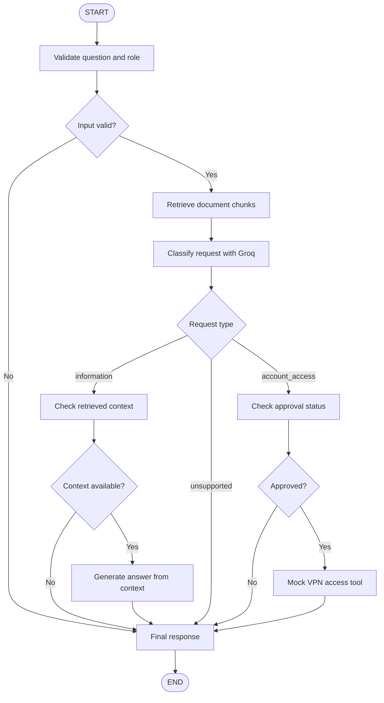
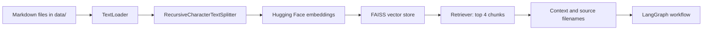

AI Onboarding Assistant
A RAG-based employee onboarding assistant built with Python, LangGraph, LangChain, Groq, FAISS, Hugging Face embeddings, and Streamlit. It answers onboarding questions from approved Markdown documents and routes account-access requests through an approval check.
Prototype limitation: The VPN tool is a mock action. It does not grant real VPN access or modify an external system.

Project Structure
AI_Onboarding_Assistant/
├── app/
│   ├── __pycache__/
│   ├── __init__.py
│   ├── graph.py
│   ├── main.py
│   ├── nodes.py
│   ├── rag.py
│   ├── state.py
│   └── Streamlit_app.py
├── data/
│   ├── onboarding_guide.md
│   ├── product_faq.md
│   ├── security_policy.md
│   └── support_escalation_guide.md
├── tests/
├── .env
└── README.md

Features
- Validates question and selected role.
- Retrieves relevant chunks from approved Markdown files using FAISS.
- Uses sentence-transformers/all-MiniLM-L6-v2 for embeddings.
- Uses Groq for request classification and answer generation.
- Classifies requests as information, account_access, or unsupported.
- Checks whether retrieval returned context before generating an information answer.
- Adds source filenames to information answers when available.
- Requires approval before running the mock VPN access tool.
- Provides a Streamlit interface and a CLI entry point.
Main Workflow Flowchart
The flow below follows the nodes and routes implemented in app/graph.py.

Route summary
- Invalid input: validate → final → end.
- Information request: validate → retrieve → classify → grounding → generate → final → end.
- Unsupported request: validate → retrieve → classify → final → end.
- Access request approved: validate → retrieve → classify → approval → mock tool → final → end.
- Access request pending or rejected: validate → retrieve → classify → approval → final → end.
RAG Pipeline Flowchart

Current settings in app/rag.py:
- Embedding model: sentence-transformers/all-MiniLM-L6-v2
- Chunk size: 800
- Chunk overlap: 100
- Number of retrieved chunks: 4 (k=4)
- FAISS index: built in memory when build_retriever() runs.
File Responsibilities
File	Purpose
app/main.py	Command-line entry point
app/Streamlit_app.py	Streamlit user interface
app/graph.py	Registers graph nodes and conditional routes
app/nodes.py	Validation, retrieval, classification, grounding, generation, approval, mock tool, final response
app/rag.py	Loads Markdown, splits text, embeds chunks, builds FAISS retriever
app/state.py	Defines shared LangGraph state with TypedDict
data/onboarding_guide.md	Laptop setup, account activation, first-day steps and VPN guidance
data/product_faq.md	Onboarding portal and product documentation guidance
data/security_policy.md	Secrets, least privilege, VPN requests and security incidents
data/support_escalation_guide.md	Support requests, escalations and security incident handling
tests/	Project test directory

State Fields
The state defined in app/state.py contains:
Field	Purpose
question	User question
role	Role: employee, manager, it_admin, or hr
retrieved_context	Retrieved text chunks
citations	Source filenames
query_type	Request label such as information, account_access, unsupported, or invalid
answer	Answer or fallback message
approval_status	pending, approved, or rejected
tool_result	Mock tool result

Setup
1. Open a terminal at the project root
The terminal directory should contain app/, data/, tests/, and .env.
2. Create and activate a virtual environment (recommended)
Windows PowerShell:
python -m venv .venv
.\.venv\Scripts\Activate.ps1
3. Install dependencies
If a requirements.txt exists in your project, run:
pip install -r requirements.txt
Otherwise, install the packages used by this project:
pip install streamlit langgraph langchain-core langchain-community langchain-text-splitters langchain-groq langchain-huggingface sentence-transformers faiss-cpu python-dotenv
4. Configure Groq
Add your API key to .env at the project root:
GROQ_API_KEY=your_groq_api_key
Do not commit .env or expose your key in code, screenshots, or chat. In app/nodes.py, use a model ID currently available to your Groq account. For example, if enabled for your account:
llm = ChatGroq(
    model="openai/gpt-oss-120b",
    temperature=0.4,
)
If Groq returns a model-not-found, authentication, or rate-limit error, check the current model list and account status in the Groq console.
Run the Application
Run these commands from the project root.
Streamlit UI
python -m streamlit run app/Streamlit_app.py
CLI
python -m app.main
Type exit to stop the CLI.
Example Questions
Information questions
- How do I set up my company laptop?
- What steps should I complete on my first day?
- Who should I contact if my account activation fails?
- What information should I include in a support request?
- What details should a VPN access request include?
- What should I do if I suspect my credentials were exposed?
- What is the onboarding portal used for?
Account-access questions
- I need VPN access.
- Please grant me access to a protected company resource.
- Create an account in the internal system.
Expected behavior: the workflow checks approval. If approved, the mock tool returns a simulated result; if rejected or pending, the tool does not run.
Unsupported-topic questions
- What is today's stock price?
- Give me personal financial advice.
- Tell me the latest external news.
- What is the weather today?
The expected classification is unsupported, but classification is LLM-based and is not guaranteed.
Limitations
- The selected role is validated, but role-specific permissions are not currently enforced by the classifier.
- Grounding checks whether context exists; it does not independently verify every answer claim against the retrieved text.
- Citations are source filenames, not page-level references.
- The FAISS index is rebuilt in memory when the retriever is initialized.
- The access tool is simulated and does not grant real access.
- Groq model availability, API credentials, and rate limits can affect requests.
Security Notes
- Keep .env private and add it to .gitignore.
- Rotate an API key if it has been exposed.
- Never place passwords, tokens, API keys, or private keys in prompts or support tickets.
- Production access actions should use trusted approval, authorization checks, and audit logging.
Test Checklist
- [ ] Streamlit starts from the project root.
- [ ] An information question returns an answer and source filenames when available.
- [ ] An access request checks approval.
- [ ] Approved requests run only the mock tool.
- [ ] Rejected and pending requests do not run the tool.
- [ ] Unsupported requests return the scope message.
- [ ] Empty questions and invalid roles are rejected.
License
No license file
